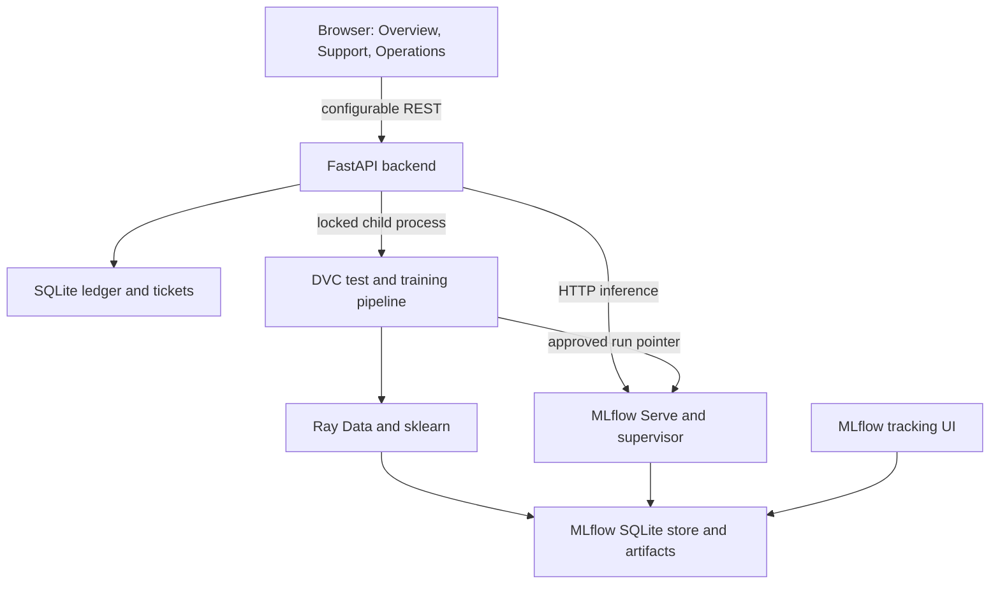
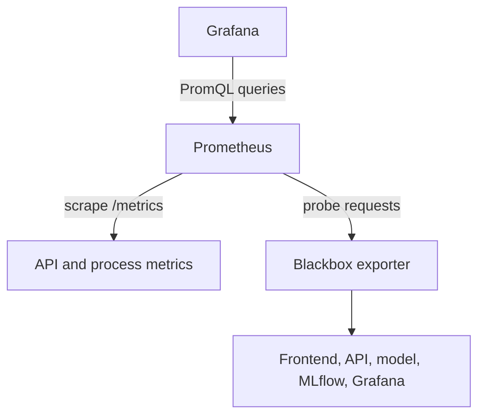
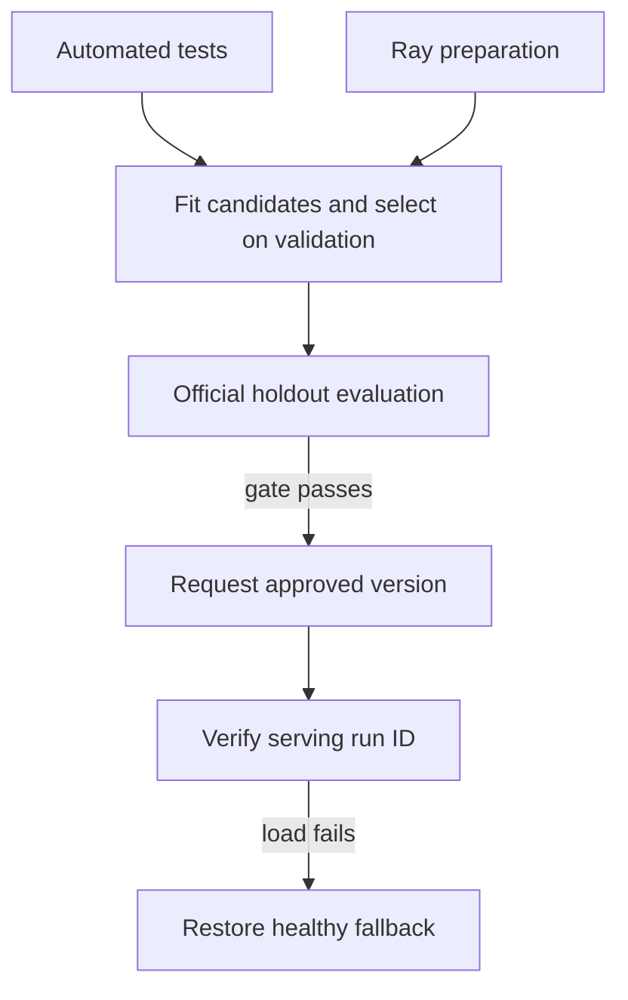

# BankFlow design

## Problem, scope and success criteria

A customer should be able to understand simulated banking transactions, correct
mistakes through an auditable reversal, and describe a banking support problem
without choosing among 77 technical labels. An operator should be able to trace
model decisions to experiments, observe service failures and data shifts, and
replace or restore a model using a tested, reproducible local pipeline.

The agreed project scope is **Banking Transaction Simulator with AI Support
Ticket Routing and AIOps**. It is a single-account educational simulator, not a
bank integration, payment processor, chatbot or authenticated banking product.
Routing assigns a local queue; it does not deliver tickets to external staff.

Measurable acceptance criteria are exact integer balances with no overdrafts or
duplicate retries; preserved reversal history; recorded classification and
human review; no ticket saved on inference failure; tests before training;
held-out macro-F1 >= 0.65; traceable model runs; a quality-gated deployment with
fallback and rollback; real Ray preparation timings; and healthy monitored
services. Full acceptance details and measurement scope are in VALIDATION.md.

## Architecture

| Block | Responsibility and boundary |
|---|---|
| Nginx/browser | Separate frontend image; renders three screens and sends JSON to the configured API. It imports no Python/model code. |
| FastAPI | Validates requests, applies ledger rules, calls the independent model service and exposes operational state and Prometheus metrics. |
| SQLite application DB | Persists append-only movements and original predictions plus review labels. The application DB is separate from MLflow's DB. |
| Ray/sklearn/DVC | Validates public data, runs automated tests, prepares Parquet, compares classifiers and enforces the quality gate. |
| MLflow | Tracks parameters, metrics, nested candidates, source and environment snapshots, features, data profiles and model/evaluation artifacts. |
| Model supervisor | Starts the real MLflow REST server. It verifies an invocation's run ID before declaring a deployment ready. |
| Prometheus/Grafana/probe | Scrapes API/process metrics and exporter health, probes five applications, evaluates alerts and renders the provisioned dashboard. |

The Python services share a mounted project directory, including local MLflow
storage and model artifacts. The frontend talks only to the API. Metrics are
pulled by Prometheus. The short-lived trainer records resource snapshots during
`cli.py check`; it is not a permanently running health-probe target.

## High-level design and rationale

The DVC DAG has `test` and `prepare` feeding `train`, followed by `evaluate`.
The driver runs test, prepare, train and evaluate in that order for a clear
Operations history. `train` depends on the successful JUnit report, so a failing
test also blocks `dvc repro train` and `dvc repro evaluate`. UI launches and
monitor-triggered launches use the same driver. Deployment is requested only
after the entire driver succeeds. DVC skips unchanged stages and stores output
hashes in `dvc.lock`; the displayed "reused" status is intentional.

| Choice | Reason | Tradeoff |
|---|---|---|
| Static HTML/CSS/JavaScript | Small separate UI with no framework build chain | Separate HTML, CSS and JavaScript require no bundler; asset caching is basic |
| FastAPI and functional pipeline stages | Explicit REST contracts, validation, and independently testable computations | Operations still relies on shared local storage |
| `Ledger` and `SupportModel` classes | Encapsulate database invariants and MLflow's model lifecycle | This is a pragmatic mix of OO boundaries and functional transformations |
| Integer paise and SQLite transactions | Exact arithmetic and atomic retry/balance/insert checks | Single-writer throughput limits large deployments |
| TF-IDF + Naive Bayes/logistic regression | Fast CPU baselines, low memory and inspectable feature weights | English closed-set intent recognition; no semantic reasoning or calibrated certainty |
| Validation macro-F1 | Gives equal importance to intents despite unequal training counts | The official test set must not be used to tune hyperparameters |
| Local Docker Compose | Fits the ARM64 VM and the no-cloud requirement | No cluster, zero-downtime deployment or production high availability |
| MLflow run URI per model | Versions remain traceable without a remote registry | Preserve the local tracking DB and artifacts to keep rollback possible |
| Length/token drift plus reviewed agreement | Lightweight, explainable monitoring | A drift flag is a heuristic, not proof of accuracy loss |

Selection uses a stratified 80/20 split of cleaned training data, seed 42. The
TF-IDF vocabulary is fitted only on fitting rows; validation examples do not
build it. Two classifiers use the same features. The selected classifier is
refitted on all cleaned training rows plus eligible reviewed feedback. Only then
is it evaluated on the untouched official test split. The fixed test gate is a
release check; repeated checking is not an independent estimate for every new
real-world distribution.

## Data and experiments

`data/banking77.zip` contains the original CSV splits, 77 labels and
`PROVENANCE.json` with upstream attribution, CC BY 4.0 license and checksums.
Preparation verifies both CSV hashes, rejects missing/blank queries and
conflicting normalized labels, deduplicates training rows and removes six
train/test overlaps from training. It preserves all 3,080 official test rows.
The cleaned training set has 9,993 rows, with 35–187 examples per intent; each
test intent has 40 examples. EDA outputs include class counts, query lengths,
vocabulary and unknown-token fractions in `data/prepared/profile.json`.

Ray Data reads CSV and applies cleaning batches; results are collected to the
driver for dataset-level deduplication and Parquet export. This is appropriate
for BANKING77, not a claim of unbounded streaming scalability. Preparation
reports total wall time and cleaned rows per second, including Ray startup.
Model timings exclude data preparation; the Operations history gives total
stage command times including DVC overhead.

The model supports five local queues: Top-ups, Cash & ATM, Transfers, Cards and
Account support. Routing checks whole issue tokens and prioritizes top-up and
cash issues so, for example, `topping_up_by_card` is Top-ups and `card_swallowed`
is Cash & ATM. Human reviews can change the effective route without overwriting
the original prediction. Queue membership is an application rule, not a second
trained classifier.

MLflow stores the parent selection run, two child candidate runs, feature
weights, final model, data profile, feedback snapshot, confusion matrix and
per-class evaluation report. Tags include Git revision, dirty-tree status,
selected classifier and quality gate. `provenance/source.zip` and its hash
manifest preserve the exact executed public code/configuration. Package versions
and platform are in `provenance/environment.json`. A dirty commit alone is
insufficient to reproduce a run; use both the recorded revision and snapshots.
The MLproject driver is separate from the candidate parent run.

## Low-level design

### Persistence and transaction invariants

`transactions` stores ID, unique request key, serialized request payload, kind,
amount, savings/card deltas, memo, optional unique `reverses` foreign key and UTC
timestamp. Balances are sums of deltas, never floating-point currency.
`BEGIN IMMEDIATE` serializes retry lookup, balance checks and insert. An identical
request key/payload replays the existing ID; a changed payload with the same key
returns 409. Savings must stay nonnegative and card debt must be in
[0, 5,000,000] paise. Reversals negate the original deltas once and cannot reverse
a reversal. Connections commit or roll back and are explicitly closed.

`tickets` stores text, original category/confidence/queue, review flag, corrected
category, source model URI and UTC timestamp. Effective corrected queue is derived
from the review label. Failed model calls or malformed predictions are rejected
before insertion. Review labels and original predictions support agreement and
feedback audits. Lists expose only the latest 100 entries; the DB retains history.

### REST contract

All API JSON uses UTF-8. Money is integer paise. There is no authentication in
this loopback-only demo. The frontend's `BANKFLOW_CONFIG` at the top of `frontend/app.js` controls
API, MLflow and Grafana URLs. Backend `MODEL_URL` controls the inference endpoint;
`FRONTEND_ORIGINS` controls browser CORS and `ALLOW_PIPELINE_RUN` enables launches.
The generated `/openapi.json` and `/docs` have named request/response schemas.

| Method and path | Input | Success output | Other statuses |
|---|---|---|---|
| GET `/health` | none | 200 `{status:"ok", mode:"simulator"}` | 500 for unexpected server failure |
| GET `/api/account` | none | 200 `Account` | 500 for unexpected storage failure |
| POST `/api/transactions` | `Transaction` | 200 `TransactionResult` | 409 rule conflict; 422 validation |
| POST `/api/transactions/{transaction_id}/reverse` | integer ID, `Reverse` | 200 `TransactionResult` | 404 missing original; 409 invalid reversal; 422 validation |
| GET `/api/categories` | none | 200 array of category strings | 500 corrupt dataset |
| POST `/api/tickets` | `Ticket` | 200 `TicketResult` | 422 invalid/blank text; 503 model timeout, failure or invalid output |
| GET `/api/tickets` | none | 200 array of `StoredTicket` | 500 storage failure |
| PATCH `/api/tickets/{ticket_id}` | integer ID, `{category: string}` | 200 `{status:"corrected"}` | 404 missing ticket; 422 unknown category |
| GET `/api/pipeline` | none | 200 `PipelineResult` | 500 unreadable/corrupt state |
| POST `/api/pipeline/run` | no body | 202 `{status:"requested", note:string}` | 403 launches disabled; 409 lock already held |
| GET `/metrics` | none | 200 Prometheus text | 500 unreadable/corrupt monitoring state |

Framework-handled errors use `{"detail": "message"}`; validation errors use a
`detail` list describing the fields. Unexpected server errors are logged without
returning tracebacks to the UI. Middleware counts them as HTTP 500 and records
latency. Support-model failures become an actionable 503 message.

| Schema | Fields and constraints |
|---|---|
| Transaction | `kind`: deposit/withdrawal/card_purchase/card_repayment; `amount_paise`: strict integer 1–100,000,000 (booleans/strings/floats rejected); `request_key`: 1–100 characters; `memo`: optional string, maximum 200 |
| Reverse | `request_key`: 1–100 characters |
| Balances | `balance_paise`, `card_due_paise`, `card_limit_paise`, `card_available_paise`: integers |
| TransactionResult | Balances plus `transaction_id`: integer and `replayed`: boolean |
| LedgerEntry | `id`, `amount_paise`, `savings_delta`, `card_delta`: integers; `kind`, `memo`, `created_at`: strings; `reverses`: integer or null; `reversed`: 0/1 |
| Account | Balances plus `transactions`: LedgerEntry array, newest first |
| Ticket | `text`: string 3–1,000 characters, trimmed, at least three after trimming |
| TicketResult | `id`: integer; `category`: BANKING77 label; `confidence`: finite number [0,1]; `queue`: one of five queue names; `needs_review`: boolean; `model_run_id`: 32 lowercase hex characters; `alternatives`: JSON-encoded string of up to three `{category, score}` objects |
| StoredTicket | `id`, `text`, original `category`, `confidence`, `queue`, `needs_review` (0/1), nullable `corrected_category` and `corrected_queue`, `model_uri`, `created_at` |
| PipelineResult | `running`: boolean; `stages`: array; `runs`: newest ten reports; nullable `metrics`, `preparation`, `monitoring`, `serving`, `retraining` objects as specified below |

The support API additionally checks that the model category is known, the queue
matches that category and the run ID is valid. Invalid scores/flags/queues return
503 without saving a ticket. MLflow's internal `/invocations` accepts
`{"dataframe_records":[{"text":"My card payment was declined."}]}` and returns
`{"predictions":[...]}`. Banking APIs never load the trained model directly.

`PipelineResult.runs` entries contain `id`, status, UTC start time, total seconds,
reviewed-training count and per-stage `name`, `status`, `seconds`, `mode`
(executed/reused); failures include `error`. Passed reports include `approved_uri`.
`metrics` contains test accuracy/macro-F1, row count, evaluation time, gate threshold,
gate result and per-class classification report. `preparation` contains row
counts, overlap removal, classes, seconds, rows/second and source hashes.
`serving` contains status (loading/ready/fallback/failed/stopped), requested URI,
active URI, previous URI and optional error. `monitoring` contains samples,
readiness, length JSD, unknown-token change, drift, active-model reviewed count
and agreement, and update time. `retraining` contains start/last-attempt times,
feedback digest, trigger reason and reviewed-row count.

### Retraining, deployment and failure handling

The monitor checks every 15 seconds. A maximum 200-ticket window needs 50 rows
before drift is assessed. JSD >= 0.12 or unknown-token increase >= 0.15 flags
drift. Retraining also needs at least five distinct eligible reviews, changed
feedback, a ready model, an idle pipeline and a one-hour cooldown. A daily check
can trigger training when new reviewed feedback exists even without drift.
It does not train repeatedly on unchanged labels or manufacture labels from
model guesses. Public split examples and contradictory reviews are excluded.

`runtime/pipeline.lock` uses a nonblocking advisory lock shared by training and
rollback. Status writes use atomic rename. A passing run updates a desired URI;
the supervisor loads it and checks a real returned run ID. Failure restores the
last active model when possible. An initial startup failure is retried. The
previous healthy URI enables rollback. Remembering the last approved candidate
prevents DVC cache reuse from silently undoing an operator's rollback. Reloading
uses a single model process and may create a short inference outage.

### Monitoring and security boundary

Metrics cover requests by method/route/status, API latency, transaction counts,
predictions by original queue, model round-trip latency/confidence, API CPU/memory,
pipeline lock, drift and active-model reviewed agreement. Five blackbox probes
check frontend, backend, model, MLflow and Grafana. Prometheus also scrapes itself
and the exporter. `up == 0` alerts catch exporter/scrape failures. Service failure
has a two-minute hold, API error rate a two-minute hold, and drift/stale monitoring
a 30-second hold. Alerts appear in Prometheus; email/Slack delivery is not configured.

Published ports bind to 127.0.0.1; model and exporter ports stay internal. Browser
CORS is restricted, SQL uses bound parameters, UI output is escaped, HTTP calls
have timeouts, monetary inputs are bounded and inference output is validated.
Only trusted locally trained joblib/pickle artifacts should be loaded. Nginx adds
nosniff and frame-denial headers. Runtime storage is not encrypted, and HTTP is
not TLS. README provides an encrypted offline-backup procedure. These controls
are scoped to synthetic data on a single-user local VM. Real banking deployment
would require authentication/authorization, TLS, encrypted storage, secrets and
key management, durable audit trails and further security testing.

## File responsibilities

The 40 files below separate independently editable responsibilities. The dataset,
tests and documentation are included in this count. Runtime outputs are not.

| File | Responsibility |
|---|---|
| `app.py` | FastAPI routes, HTTP instrumentation and the background monitoring task |
| `ledger.py` | SQLite schema, transactional money rules, audit entries and ticket persistence |
| `schemas.py` | Pydantic request, response and inference validation contracts |
| `routing.py` | BANKING77 category-to-queue rules shared by inference and reviews |
| `data_pipeline.py` | Dataset hashes, Ray cleaning, reference profiles, drift calculations and feedback filtering |
| `training.py` | Candidate comparison, MLflow provenance, feature reports and held-out quality gate |
| `pipeline.py` | DVC stage execution, run lock, monitored retraining and deployment/rollback decisions |
| `model.py` | MLflow inference wrapper and invocation-verified serving supervisor |
| `cli.py` | Host/VM commands for training, verification, demo and rollback |
| `verify.py` | Live API acceptance and optional full VM lifecycle checks |
| `frontend/index.html` | Semantic markup for account, support and operations screens |
| `frontend/styles.css` | Visual styling and responsive layouts |
| `frontend/app.js` | Service URLs, forms, HTTP requests, state updates and escaped rendering |
| `frontend/nginx.conf` | Static frontend delivery, health route and response headers |
| `tests/conftest.py` | Temporary database and HTTP-client fixtures |
| `tests/test_ledger.py` | Balance, retry, concurrency, reversal and saved-review tests |
| `tests/test_api.py` | HTTP contract, validation, metrics and inference-error tests |
| `tests/test_training.py` | Leakage, preparation, feedback, queue and drift tests |
| `tests/test_pipeline.py` | Test-stage rejection, retraining policy and rollback tests |
| `monitoring/prometheus.yaml` | Scrape intervals, API/exporter targets and application probes |
| `monitoring/alerts.yaml` | Service, scrape, API error, drift and stale-monitor alert rules |
| `monitoring/alert_tests.yaml` | Promtool fixtures for service and drift alert firing/recovery |
| `monitoring/blackbox.yaml` | HTTP probe module and timeout |
| `monitoring/grafana_datasource.yaml` | Grafana connection to the local Prometheus service |
| `monitoring/grafana_provider.yaml` | Grafana dashboard provisioning location |
| `monitoring/grafana_dashboard.json` | Dashboard panels, units and PromQL queries |
| `Dockerfile` | Separate Nginx frontend and shared Python build targets |
| `requirements.txt` | Direct Python dependency version pins |
| `compose.yaml` | Service commands, resource limits, volumes, ports and configuration mounts |
| `params.yaml` | Preparation, classifier, quality-gate and monitoring parameters |
| `dvc.yaml` | Tested data/model dependency graph and generated outputs |
| `MLproject` | MLflow project entry point using the same Python image |
| `data/banking77.zip` | Original public dataset, labels, license attribution and hashes |
| `README.md` | Installation, user manual, demo, reproduction, submission and disclosure |
| `DESIGN.md` | Architecture, HLD, LLD/API contracts, rationale and this file guide |
| `VALIDATION.md` | Rubric mapping, test plan, results, pending VM checks and viva preparation |
| `evidence/test-results.xml` | Machine-generated pytest outcomes for this structure |
| `evidence/audit.json` | Source hashes, scoped checks and recorded validation outcomes |
| `.gitignore` | Excludes generated stores, caches and local environment settings |
| `.dockerignore` | Excludes generated/local files from the Docker build context |

The root Python modules form one small application. Folders group static frontend
assets, tests and monitoring configuration; no framework scaffolding is required.
Business rules stay in the ledger, HTTP contracts in schemas, model fitting outside
the API, and host Docker commands outside the DVC orchestration logic.
